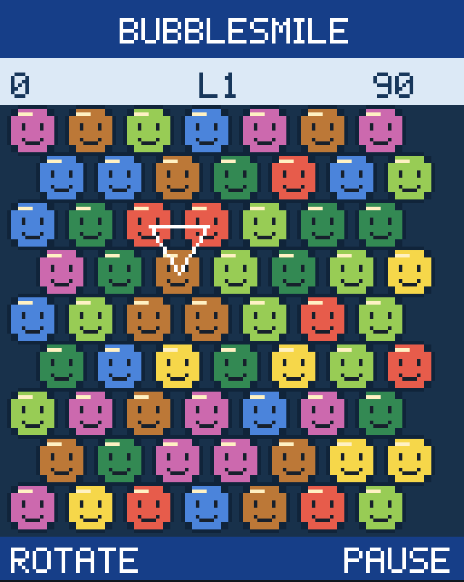
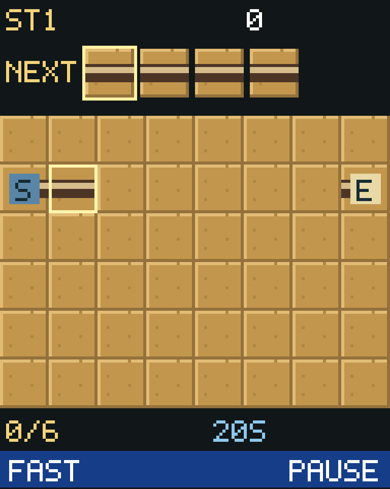

# Authenticity and validation report

## Status

**Playable evidence-informed approximations. Historical SGH-P510 equivalence is unverified.** No original P510 firmware/game file, gameplay frames, readable manual or exact-phone screenshots were obtained. The user-provided Rutube URL failed at proxy CONNECT (403); its game identity is UNKNOWN. No frame analysis or sound analysis is claimed.

The implementation does not satisfy the stronger goal of a verified original-phone reconstruction. It provides two independently playable games based on the closest actually inspected evidence, with uncertainty recorded in [BubbleSmile](research/BubbleSmile.md), [Fun2Link](research/Fun2Link.md), [hardware](research/SGH-P510-hardware.md), and the [source/access log](research/sources.md).

## Evidence versus implementation

| Aspect                    | Evidence actually inspected                                                                                                            | Browser implementation / discrepancy                                                                                                                              |
| ------------------------- | -------------------------------------------------------------------------------------------------------------------------------------- | ----------------------------------------------------------------------------------------------------------------------------------------------------------------- |
| BubbleSmile core          | Independent catsmile remake source                                                                                                     | Three-bubble triangular rotation, horizontal and diagonal line removal, seven colors, replacement falls; not verified on P510                                     |
| BubbleSmile artwork       | No original screenshot available                                                                                                       | Independent 14 × 14 smile faces, colors and layout all approximations                                                                                             |
| BubbleSmile motion        | Remake rotates and drops circles                                                                                                       | 180 ms pixel-stepped rotation and blinking clear; refills snap rather than reproducing original drop animation                                                    |
| Fun2Link core             | X120 port Java sources, stage.0, viewed Screenshot_2.png                                                                               | Queued pipes, timed water, compatible directional connections, minimum length and sink; P510 identity unknown                                                     |
| Fun2Link layout           | X120 screenshot shows four queued pieces, ochre textured ground, brown dimensional pipes, black margin, purple Fast/yellow Back labels | Four-piece queue and ochre board retained in broad style; simpler flat independent tiles, eight fully visible columns, header score and blue softkey strip differ |
| Fun2Link sprite placement | X120 source draws 16-pixel cells with clipped border                                                                                   | Browser draws 16-pixel cells without X120 clipping; source/sink use independent S/E labels rather than copied artwork                                             |
| Screen                    | No verified P510 dimensions                                                                                                            | Provisional 128 × 160; must be corrected if original evidence contradicts it                                                                                      |
| Fonts                     | X120 screenshot has heavy outlined lettering                                                                                           | Independent 5 × 7 bitmap alphabet; no claim font dimensions match Samsung                                                                                         |
| Menus                     | No original P510 menu frame                                                                                                            | Blue Samsung-inspired two-item menu with two softkey labels; approximate colors and positions                                                                     |
| Sound                     | X120 repository has MMF filenames; sounds not listened to or decoded                                                                   | Synthesized opt-in square-wave tones, explicitly approximate; no original music                                                                                   |
| Score, levels, timer      | Partial related-source behavior, not P510 formula                                                                                      | Independent progression, reproducible seeds, documented provisional scoring and timer values                                                                      |
| Input                     | X120 port README: arrows, place, fast, menu                                                                                            | Pointer Events and keypad-like desktop mapping; natural browser adaptations, original P510 mapping unknown                                                        |

The X120 screenshot was viewed directly; it is not an original P510 frame and not an equivalent in-game state. Consequently no numerical pixel-difference score, pixel-perfect claim or exact sprite comparison is meaningful. Original artwork/code/audio were not copied from the reference repositories, which had no root license file identified.

## Implementation screenshots

These are real canvas screenshots captured by Playwright, not historical references. The mobile-sized Chromium capture uses device scale factor 3; the stored image is scaled relative to the internal 128 × 160 framebuffer. Test outputs can be regenerated with `npm run build && npm run test:browser`.

Screenshot inspection found and corrected bottom-row BubbleSmile clipping and a repeated Fun2Link queue piece. Selection triangles now use integer pixel line rasterization. No unrelated stock assets are used.

## Executed validation

- Node 24 dependency installation and repeatable `npm ci` with a frozen lockfile: passed.
- TypeScript checks: passed.
- Vitest: 19 tests passed across two files, covering both engines and fixed-step behavior at 60/90/120 Hz, pause reset and long-stall limits.
- Production build: passed with seven emitted files in the offline precache (plus root document alias).
- Chromium desktop and mobile-sized browser suite: 11 passed, 1 intentionally skipped (touch-only scenario on desktop). Launch/switch, keyboard, pointer cancel, sound preference, restart, score separation, resize, offline reload, real touch dispatch, paused-frame stability and full Fun2Link stage clear/advance/failure/restart exercised.
- Repository base `/Samsung_SGH-P510_Games/`: production build and same browser suite passed, including offline reload under that scope.
- The first offline test failed because cached Vite responses varied by Origin. Cache matching for this static application now ignores that variation; repeated offline checks passed after correction.

No physical iPhone/Android test, Safari/WebKit test, audible waveform comparison, GitHub-hosted workflow execution, live Pages deployment, or fresh-cloud-snapshot restoration is claimed. Browser tests exercise functional input and behavior, not historical authenticity.

## Remaining preservation work

1. Obtain direct upload of the user's Rutube video or allow access to its actual frames/media. Establish which game/handset/version it demonstrates before treating it as P510 evidence.
2. Obtain a readable exact-phone manual and verified hardware specification; establish main LCD versus outer LCD, game viewport, colors, softkeys and native/Java packaging.
3. Obtain legally reusable exact-phone screenshots, stage data and sound references. Record frame timestamps and provenance, then compare equivalent states against these browser captures.
4. Replace provisional art, formulas, timers, layouts, stages and controls only when supported by evidence; update every affected confidence label and regression test.
5. Validate on physical iOS Safari and Android Chrome, including home-screen installation and offline cold launch.

Research domains and repeatable installation/start instructions were saved as a cloud environment configuration draft. Saving does not apply or publish that configuration. Review and save the changes in environment settings, then publish when appropriate. No push or deployment was performed.
