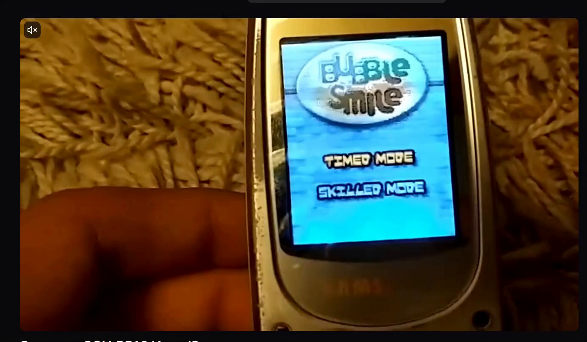
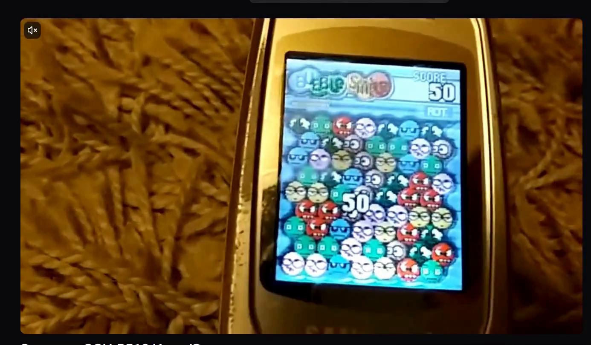
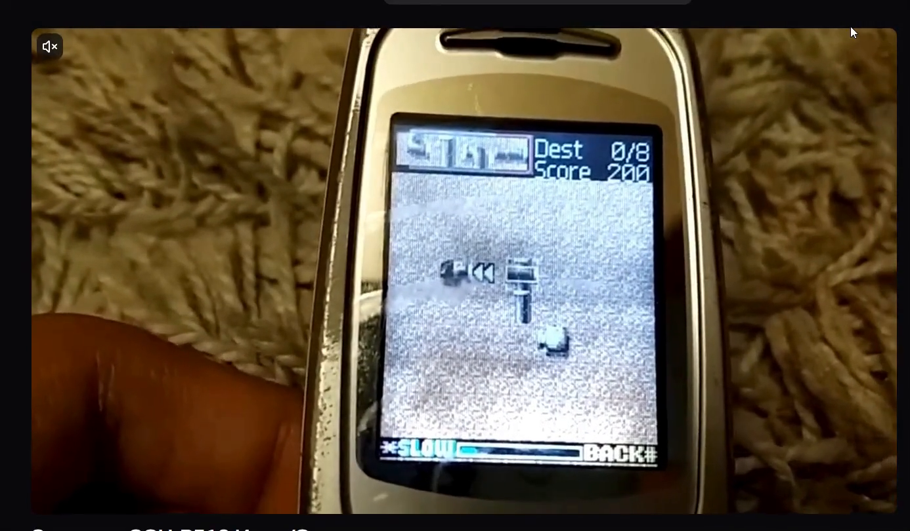
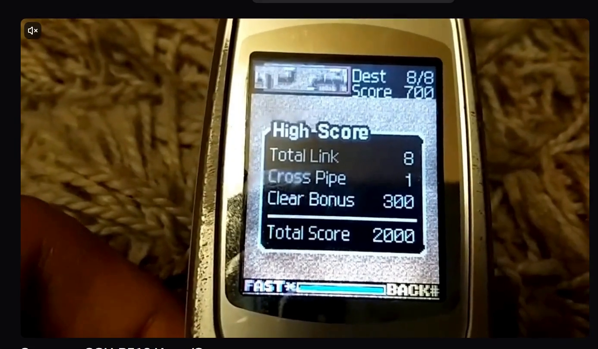

# Uploaded handset footage: frame analysis

Analysis date: 2026-10-27 (Asia/Tbilisi). The files were successfully downloaded and their actual decoded frames inspected. This supersedes the earlier inability to transfer the first, oversized upload. The Rutube URL itself was not accessed and correspondence between these clips and that URL is not independently verified.

## Provenance and limits

| File                     | Duration | Decoded video             | SHA-256                                                            |
| ------------------------ | -------- | ------------------------- | ------------------------------------------------------------------ |
| `Untitled design.mp4`    | 56.576 s | H.264, 1386 × 810, 30 fps | `18b08022ba6c74632ba621aa6296064e2022aa85509545f14edeaed984b21c2c` |
| `Untitled design(1).mp4` | 73.408 s | H.264, 1386 × 810, 30 fps | `a6d25e278452011aec4deb7be8738c44aab15ea7222d61307e097290cac8020d` |

These are screen recordings of camera footage, with player chrome, camera movement, perspective and LCD moire. 1386 × 810 is the uploaded video frame size, NOT the handset LCD resolution. The handset looks consistent with the user's P510 attribution, but no readable model label was inspected: exact handset identity remains STRONGLY INFERRED from provenance, not independently VERIFIED. Confidence below distinguishes visible footage facts from claims about every P510 variant.

Both files have 48 kHz AAC tracks. Decoding the complete tracks to signed 16-bit PCM yielded zero nonzero bytes (10,862,592 and 14,094,336 bytes respectively). They are digitally silent. The on-screen player also shows mute. This verifies silence of these uploads, not absence of sound in the original games. No original sound analysis is possible from these files.

Times below are offsets in the uploaded files, not the underlying video's on-screen timeline. Full-size selected frames were extracted with ffmpeg `-ss <seconds> -i <file> -frames:v 1` and viewed. Contact sheets were discovery aids; their cells are not used as exact timestamp evidence.

## BubbleSmile: `Untitled design.mp4`

Game identity: VERIFIED by the visible Bubble Smile logo.

| Offset      | Direct observation                                                                                                               | Classification                                                                   |
| ----------- | -------------------------------------------------------------------------------------------------------------------------------- | -------------------------------------------------------------------------------- |
| 00:00       | Aqua title screen, oval Bubble Smile logo, `TIMED MODE` and `SKILLED MODE`                                                       | VERIFIED in footage                                                              |
| 00:02–00:04 | Skilled Mode highlighted after the earlier Timed Mode highlight                                                                  | VERIFIED in footage; subsequent gameplay being Skilled Mode is STRONGLY INFERRED |
| 00:06       | Staggered character board, logo left, `SCORE` right, thin horizontal strip with `ROT.` at right; clearing leaves temporary holes | VERIFIED in footage                                                              |
| 00:12       | Score 50; large temporary `50` over board                                                                                        | VERIFIED in footage                                                              |
| 00:24       | Score 266; large `140` and `COMBO 4` popup                                                                                       | VERIFIED in footage                                                              |
| 00:38       | Score 475; seven distinguishable face styles visible across dense staggered rows                                                 | VERIFIED in footage                                                              |

Observed faces: turquoise square eyes, blue sunglasses, red angry face with teeth, pale lavender sleepy/shy face, yellow sleepy face, dark green angular white eyes, grey/brown large sideways-looking eyes. These categories are VERIFIED visual observations; exact RGB values, per-frame expression changes and original sprite pixels are UNKNOWN due to scaling, camera white balance, perspective and moire.

The board changes, holes, refilling and combo popups support clearing/cascades. The independent remake documents triangular rotations, but sampled footage does not establish every rotation/matching restriction or the full score formula. Seven columns and nine staggered rows are STRONGLY INFERRED from visible frames plus the remake, not an extracted original board definition. The thin strip's exact role, Skilled Mode failure condition, Timed Mode behavior, controls and original timing remain UNKNOWN. No mode-completion or game-over screen is shown in the inspected samples.

## Pipe game: `Untitled design(1).mp4`

Identity: STRONGLY INFERRED as Fun2Link from its distinctive source/sink pipe mechanic, queue, destination requirement and crossing system matching the inspected X120 Fun2Link implementation. A readable Fun2Link title was not present in inspected frames; do not treat the filename as a title or claim independent title verification.

| Offset      | Direct observation                                                                                         | Classification                                                                                         |
| ----------- | ---------------------------------------------------------------------------------------------------------- | ------------------------------------------------------------------------------------------------------ |
| 00:02–00:05 | `Java powered` / `Open Game` launch screen                                                                 | VERIFIED in footage; Java launch association STRONGLY INFERRED, not proof of a P510 binary's packaging |
| 00:12       | `Stage 1`, grey textured ground, source/sink shapes, queue in upper left, `*SLOW` and `BACK#` along bottom | VERIFIED in footage                                                                                    |
| 00:26       | Top `Dest 0/8`, `Score 200`; laid pipes and cursor; no outlined grid around empty cells                    | VERIFIED in footage                                                                                    |
| 00:57       | `Dest 8/8`, `Score 700`; cyan water traversing a route with a crossing/loop                                | VERIFIED in footage                                                                                    |
| 00:60–00:63 | Water extends towards sink; bottom `FAST*`, cyan meter                                                     | VERIFIED in footage                                                                                    |
| 00:65       | `High-Score` panel: `Total Link 8`, `Cross Pipe 1`, `Clear Bonus 300`, `Total Score 2000`                  | VERIFIED in footage                                                                                    |
| 00:70       | `Java powered` / `Close Game` screen                                                                       | VERIFIED in footage                                                                                    |

The observed target eight, intermediate 700 and final 2000 do not identify a general score formula. In particular, the old browser formula of 100 per traversal plus 500 clear bonus is not supported by this recording. The stage requires a route of sufficient length and visually supports crossing channels. Whether target eight counts source/sink, crossing revisits or unique pipe cells is not proved by these samples. Queue end consumed, exact board geometry, replacement penalties, stage definitions and normal/fast timing require finer event-by-event study. Player pauses/cuts prevent deriving original speed from uploaded elapsed time alone.

## Implemented corrections and deliberate limits

- BubbleSmile now uses an aqua patterned field, logo/score header, `ROT.` strip and seven independently drawn face styles instead of identical smiles. The unsupported blue gameplay footer was removed; browser controls remain outside the viewport. Colors and 14–15-pixel sprites remain APPROXIMATED, not extracted original assets.
- Fun2Link now uses static grey textured ground without visible empty-cell borders, metallic dark/light pipes, upper-left queue, upper-right Dest/Score HUD, cyan meter/water, and Fast/Slow plus Back# footer.
- Fun2Link Back and keyboard # return to the launcher; Escape still provides the browser pause adaptation.
- The existing approximate BubbleSmile timer/level rules and Fun2Link scores/stages have not been reclassified as authentic. Timed/Skilled mode choice is documented but not implemented because its distinguishing rules remain unresolved. The current implementation must not be described as the filmed Skilled Mode.
- Reference frames are research evidence, never gameplay textures or sprite sheets. Full uploaded videos remain outside the Git repository. No exact pixel comparison is claimed; the comparison is qualitative because the camera recording is not a native framebuffer capture.
